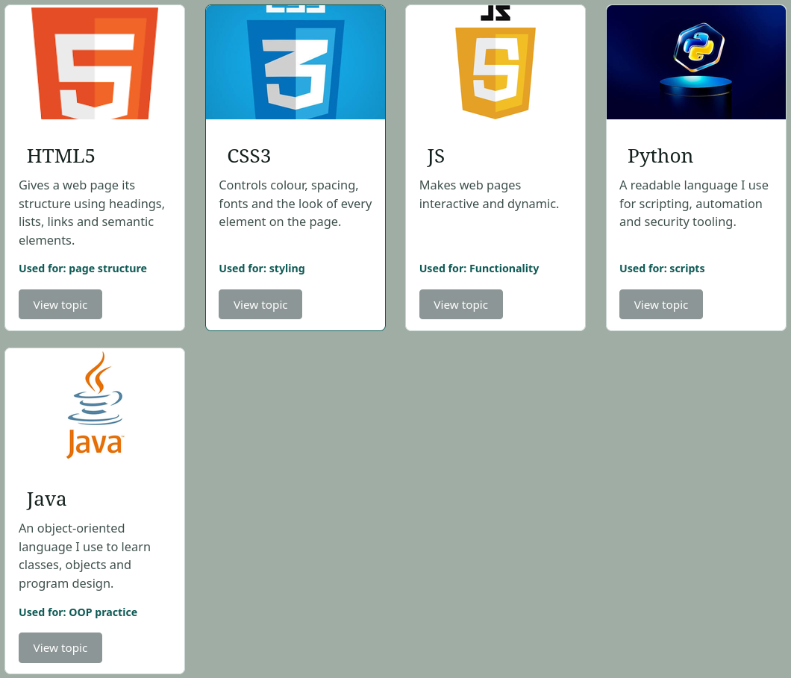
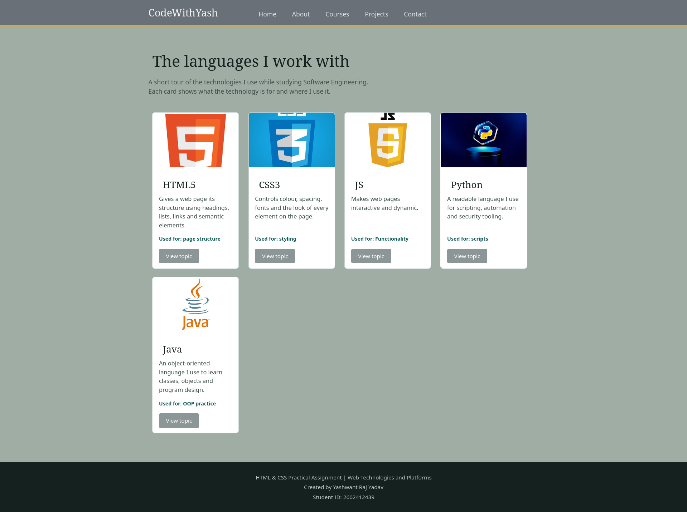

#                                                                ## HTML & CSS Practical Assignment ##

## 1. Student Information

- **Student Name:** Yashwant Raj Yadav
- **Student ID:** 2602412439
- **Module Name:** Web Technologies and Platforms
- **Assignment Title:** Designing a Navigation Bar and Card Components Using HTML & CSS

## 2. Project Description

This project is a basic HTML and CSS webpage containing a navigation bar, a technology card component, a section of four cards, and a complete page with header, main content and footer. It uses only the HTML structure and fundamental CSS styling taught so far (no Flexbox, Grid, Bootstrap, Tailwind or JavaScript).

 

## 3. Technologies Used

- HTML5
- CSS3

## 4. Learning Resources

| No. | Resource                    | Topic Learned  |             What I Learned                                                                                             |
|-----|-----------------------------|----------------|----------------------------------------------------------------------------------------------------------------------- |
| 1 | Teacher's Material            | CSS Selectors  | I learned that element selectors style every tag of one type than class selectors (.)

| 2 | University Material           | HTML Structure | I learned that semantic elements describe what each part of a page is for

| 3 | W3Schools: CSS Navigation Bar | Navigation Bar | I learned that a nav menu is a list of links, and that removing the bullets and setting display on the list items turns it into a horizontal bar.

| 4 | MDN Web Docs: CSS box model   | CSS Box Model  | I learned that padding adds space inside the border, and margin adds space outside it. 

| 5 | MDN Web Docs: display         |Display property| I learned that inline-block lets elements sit next to each other on one line while still accepting width, height and margin. 

## 5. Screenshots

### Navigation Bar

### Single Card

### Multiple Cards

### Complete Website

-->

## 6. What I Learned

- **HTML page structure and semantic HTML:** I learned that a page is organised with a `head` and a `body`, and that semantic elements like `header`, `nav`, `main`, `section`, `article` and `footer` describe the purpose of each part. This made my code easier to read and understand.
- **CSS selectors:** I learned that element selectors style every tag of one type (like `body` or `h1`), while class selectors (like `.tech-card`) style only the elements that have that class. I used classes for the components so each one has its own styling.
- **Colours and units:** I learned to use hex colour codes for text and backgrounds, and pixels (`px`) for sizes such as widths, heights and spacing. I kept a small set of colours so the whole page looks consistent.
- **Typography and text properties:** I learned to change `font-family`, `font-size`, `color`, `text-align`, `text-decoration` and `line-height`. For example, `text-decoration: none` removed the underline from links, and `line-height` made the text easier to read.
- **Image properties:** I learned to control images with `width`, `height` and `object-fit: cover`, so every card image has the same size and is not stretched.
- **Margin, padding, border and border radius:** I learned that padding is the space inside an element, margin is the space outside it, and the border sits between them. I used padding to give the card text breathing room, margin to separate the cards, and `border-radius` to round the corners.
- **Hover effects:** I learned that `:hover` changes the style only while the mouse is over an element. I used it on the navbar links, the card buttons and the card borders to give visual feedback.
- **Basic positioning and alignment:** I learned that `margin: 0 auto` centres a block with a fixed width, and that `display: inline-block` puts elements side by side while still allowing width, height and margin. This is how I made the navbar and the row of cards without Flexbox or Grid.

## 7. Challenges and Solutions

**Challenge 1:** My navigation links were stacked vertically and still had bullet points, because they were in a normal list.
**Solution:** I used `list-style-type: none` to remove the bullets, then set `display: inline-block` on the list items so they sit in one line. I also used `padding` on the links so the spacing between them is even and the hover area is bigger.

**Challenge 2:** The cards had different heights because their descriptions had different lengths, so the buttons did not line up.
**Solution:** I gave every card the same fixed `height` and gave the description paragraph a fixed height as well. This keeps all the cards and buttons aligned and consistent.

**Challenge 3:** The card images looked stretched and the image corners were not rounded to match the card.
**Solution:** I studied CSS image properties and set `width: 100%`, a fixed `height` and `object-fit: cover`. I also added `overflow: hidden` to the card so the image follows the card's rounded corners.
